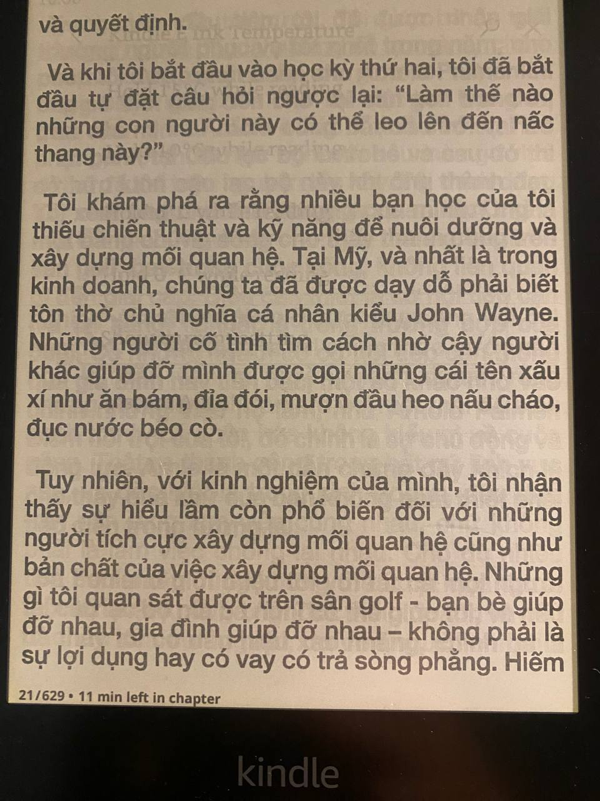
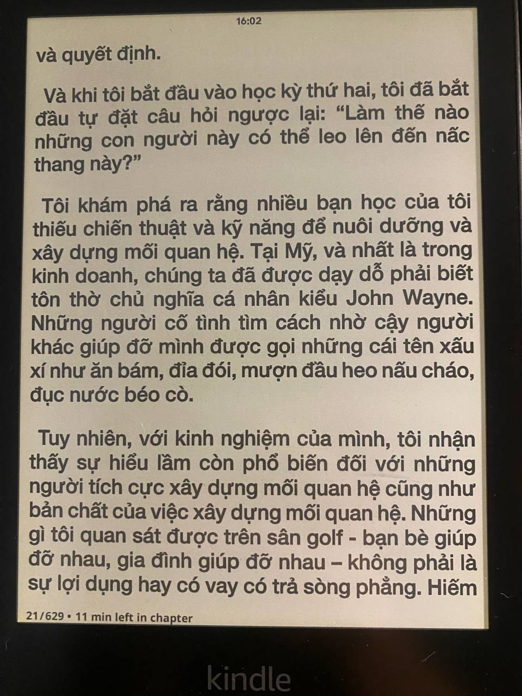
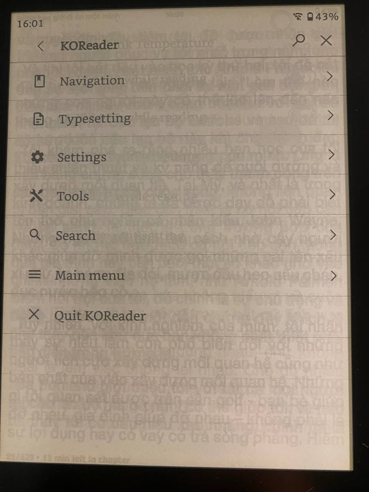
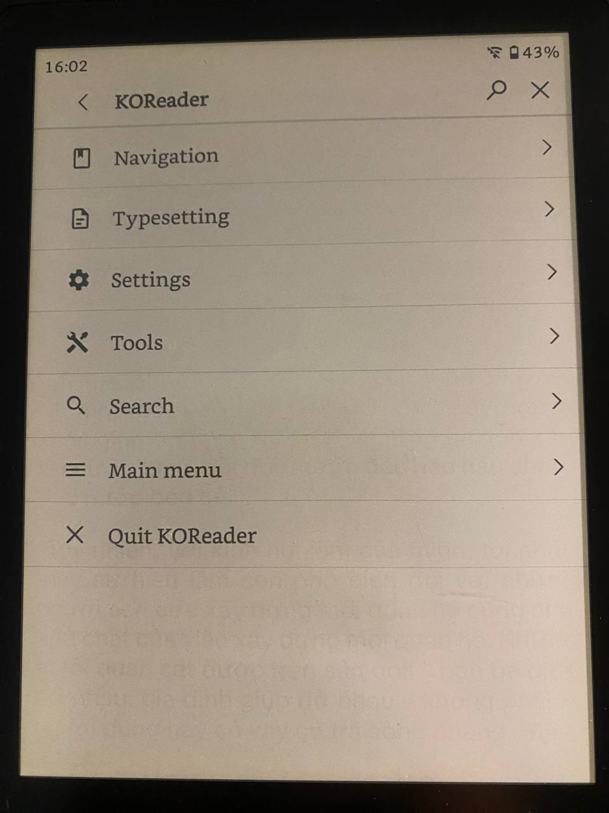

# Kindle E Ink Contrast cho KOReader

[English](README.md)

[Tải ZIP cài đặt plugin KOReader](https://github.com/mkdayyyy/kindle-eink-contrast/releases/download/v0.3.3-preview/kindle-eink-contrast-v0.3.3-preview-plugin.zip)

Plugin dành cho Kindle có chữ rất nhạt, nhìn như có lớp sương phủ lên trang, và vẫn thấy bóng chữ của trang trước sau khi lật trang. Hiện tượng bóng chữ còn sót lại gọi là **lưu ảnh E Ink** (*ghosting*).

Plugin gửi một giá trị nhiệt độ thấp hơn cho driver màn hình để máy có thể chọn dạng sóng làm mới khác trong bảng có sẵn. Dạng sóng là chuỗi xung dùng để di chuyển hạt mực E Ink. Mục đích là **làm chữ đậm hơn và giảm bóng chữ**.

**Kết quả trên một máy Paperwhite 5:** Ở chế độ mặc định, chữ rất nhạt và còn bóng trang trước. Khi đặt **10°C**, người dùng thấy chữ đậm và rõ hơn, không còn thấy bóng chữ khi đọc. Đổi lại, lật trang chậm hơn và màn nháy lâu hơn. Hiệu quả tùy vào tấm màn, firmware và mức nhiệt đã chọn.

## So sánh trước và sau trên Kindle Paperwhite 5

Mỗi cặp chụp cùng một nội dung trên cùng một máy. Ảnh gốc được hiển thị cùng chiều rộng, góc chụp có chênh lệch nhẹ.

### Cùng một trang sách

| Trước | Sau khi bật plugin |
| :---: | :---: |
|  |  |

### Cùng một menu KOReader

| Trước | Sau khi bật plugin |
| :---: | :---: |
|  |  |

## Cài đặt và sử dụng

1. Thoát KOReader và giải nén ZIP plugin ở đầu trang. Chép `kindle-eink-contrast.koplugin` vào `koreader/plugins/` trên Kindle. Nếu đã cài bản cũ, xóa thư mục `kindle-eink-temperature.koplugin` hoặc `ppw5einktemp.koplugin` trước khi mở lại KOReader.
2. Mở lại KOReader và mở một cuốn sách. Vào **bánh răng → Screen → Kindle E Ink Contrast**. Menu dùng tiếng Anh.
3. Chọn mức nhiệt muốn giữ khi đọc (20°C, 15°C, 10°C, 5°C hoặc 0°C). Lật trang để so độ đậm và bóng chữ với Auto. Chọn **Restore Auto** để trả về mặc định.

Plugin tạm về Auto khi bạn đóng sách hoặc khi Kindle ngủ, rồi áp lại mức đã chọn khi đọc tiếp trong cùng phiên KOReader. Sau khi thoát hẳn và mở lại KOReader, bạn có thể chọn lại mức muốn dùng.

Nếu KOReader treo hoặc báo không trở về Auto, hãy khởi động lại Kindle. Để gỡ, thoát KOReader rồi xóa `kindle-eink-contrast.koplugin` khỏi `koreader/plugins/`.

## Tương thích

Plugin nhận diện Paperwhite 1–6, Paperwhite 5 Signature Edition, Oasis 1–3, Voyage, Kindle Basic (2014, 2016, 2019, 2022 và 2024) và Kindle Scribe (2022 và 2024). Người đóng góp đã thử trên Scribe đời 2024. Menu chỉ hiện khi model, driver và cấu trúc lệnh làm mới cùng khớp.

**Show current setting** hiển thị nhiệt độ và dải dạng sóng mà driver MediaTek báo. Với driver NXP, mục này hiển thị giá trị KOReader gửi trong lệnh làm mới màn. Nếu báo kết quả trên máy khác, vui lòng ghi model, firmware, phiên bản KOReader và mức nhiệt đã dùng.
